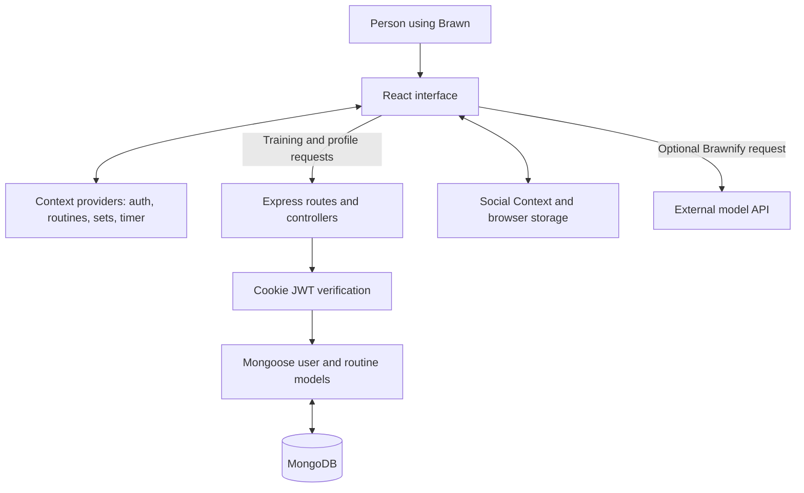

# Brawn

**Plan a routine. Train with a timer. Keep a record. Share the session.**

Brawn is a full-stack fitness application that brings workout planning, exercise logging, session timing, and activity summaries into one place. It also includes **Brawnify**, an optional AI routine builder, and a social fitness prototype with posts, stories, reels, and message threads.

**React 18 · JavaScript · Node.js · Express · MongoDB · Mongoose · Tailwind CSS**

[Features](#key-features) · [How it works](#how-it-works) · [Architecture](#architecture) · [Getting started](#getting-started) · [Technical guide](docs/technical-guide.md)

## At a glance

| Question | Answer |
| --- | --- |
| Who is it for? | People who want to organize strength, timed, and cardio workouts and follow a routine while training. |
| What problem does it solve? | Keeps the exercise plan, sets, timer, and completion record together instead of spreading them across notes and separate tools. |
| What is the main workflow? | Sign in → build a routine → add exercises and sets → train → save a completion summary. |
| What makes it interesting technically? | Nested MongoDB data modeling, authenticated Express APIs, shared React state, reusable controls, timers, and generated AI output saved as application data. |
| Where is data saved? | Training and profile records use MongoDB. Social prototype interactions use the current browser's storage. |
| What is its current status? | A development project with a database-backed training core and an expanded social UI prototype. Public deployment is not verified. |

## Overview

A routine is a repeatable training plan, such as "Upper Body A." Inside it are exercises, such as bench press, and sets describing how much weight, how many repetitions, or how long to train. Brawn lets a user create that plan, follow it with a timer, and save a completion summary afterward.

For example, someone can create a routine with three exercises, enter four sets for each, start a session, mark sets complete, and use a rest timer between sets. When they finish, the backend records the completion date, session time, and total lifting volume. A sharing screen can then turn the session into a browser-local post.

The repository demonstrates both **full-stack application development** and **interactive product UI**. The distinction matters: workout records have a backend; the social screens currently demonstrate interactions within one browser.

## Key features

### Workout planning and logging

- **Routine management:** create, view, rename, edit, and delete training plans.
- **Exercises and sets:** manage exercises inside a routine, with weight/repetition, timed, and cardio fields.
- **Live workout mode:** start or pause a session, check off completed sets, and configure rest timers.
- **Completion records:** save when a routine was completed, elapsed time, and lifting volume calculated from its stored sets.
- **Exercise reference:** browse a bundled catalog of **35 exercises**, including equipment, muscle groups, aliases, instructions, technique cues, and common mistakes.
- **Activity and profiles:** review completion counts, streak calculations, training summaries, and routine-distribution charts; edit profile/body information.

### Social fitness prototype

- **Feed and stories:** compose posts, add comments, like, save, repost, and share items into local message threads.
- **Creator studio:** select photo/video media, enter workout details, and adjust visual presentation with filters and crop/transform controls.
- **Reels and discovery:** browse sample media/profiles and use playback, comment, save, follow, hide, and report controls.
- **Messages:** search or create conversations, compose text, attach files, and view shared feed items.
- **Shared UI state:** the feed, creator, reels, and messages connect through a common social Context provider.

These screens use seeded content and browser-local storage. They do not currently deliver messages to other users, upload media to a server, or make real voice/video calls. Sample engagement counts represent demonstration content.

### Brawnify: optional AI routine builder

Brawnify turns a written training request into routine or exercise data. It can create a routine, revise a selected routine, add an exercise, and produce training explanations using available routine/profile context.

The application calls the OpenAI Chat Completions API, parses the generated JSON, normalizes exercise fields, and saves routines through the same API used by manual editing. Loading/error states are included, and routine removal requires typing `DELETE`.

**Integration boundary:** model requests currently originate in the browser using `REACT_APP_OPEN_AI`. That variable becomes part of the client bundle. Move requests and secrets to the backend before enabling the feature in a shared deployment. Manual workout planning does not require AI.

## How it works

### Follow a workout

1. **Sign in:** the backend checks credentials and sets a JWT cookie. A JWT is a signed token used to verify a session.
2. **Build a routine:** React forms send exercise/set data to the Express API, the server interface used by the app.
3. **Save the plan:** Mongoose checks the document shape and stores the routine in MongoDB.
4. **Train:** React manages the session timer, rest timer, and checked-off sets.
5. **Complete:** the API appends the date, elapsed time, and calculated volume to the routine.
6. **Share:** the composer can create a local social post containing a workout summary.

```text
Routine: Upper Body A
  Exercise: Bench Press
    Set 1: 40 lb x 10 repetitions
    Set 2: 40 lb x 10 repetitions

Lifting volume = (40 x 10) + (40 x 10) = 800 lb
```

Volume is a training summary, not a measure of fitness improvement. Completion records summarize the saved routine; they are not immutable snapshots of every performed set.

### Generate a routine with Brawnify

```text
Written request + selected routine/profile context
    → prompt sent to the external model
    → returned JSON is parsed and exercise fields are normalized
    → routine/workout API saves the generated data
    → the routine becomes editable in the regular training interface
```

This is an API integration with an external model, rather than a model trained by this project.

## Architecture

**In plain language:** React handles the screens, Express handles requests, and MongoDB remembers the training data. React Context shares state between screens. Browser storage keeps the social prototype's local interactions.



The diagram shows component responsibilities. Cookie authentication is implemented; ownership enforcement still needs strengthening in nested workout/set and profile handlers. See [current limitations](#current-limitations).

### Data model

```text
User
  └── Routine
        ├── Workouts (exercises)
        │     └── Sets: weight, repetitions, time
        └── Completion summaries: date, totalTime, totalWeight
```

Embedding exercises and sets keeps a routine together in one MongoDB document. This makes the plan straightforward to load and edit. A separate completed-session model would be needed for a full historical record of performed sets.

## Tech stack

| Layer | Technology | Purpose |
| --- | --- | --- |
| Interface | React 18, JavaScript, React Router | Screens, interactions, and page navigation |
| Shared UI state | React Context and hooks | Authentication, routine/workout/set data, timers, and social actions |
| UI components | Tailwind CSS, Radix-based primitives, Lucide | Styling, reusable controls, dialogs, tabs, and icons |
| Charts and motion | Recharts, Anime.js | Training visualizations and animated UI elements |
| API | Node.js, Express 4 | HTTP routes and application request handling |
| Database | MongoDB, Mongoose | User records, embedded routines, validation, and persistence |
| Authentication | bcryptjs, JWT, cookie-parser, CORS | Password hashing, signed cookies, and browser/server request handling |
| Optional AI | OpenAI Chat Completions API integration | Generated routines, exercises, and explanations |
| Tests and build | Jest, React Testing Library, Create React App | Component interaction checks and frontend builds |

## Engineering highlights

| Work demonstrated | Where to inspect it |
| --- | --- |
| Nested routine/exercise/set APIs and embedded document modeling | [Models](backend/models/), [routes](backend/routes/), [controllers](backend/controllers/) |
| Live session and configurable rest timers | [Workout page](frontend/src/pages/WorkoutPage.js), [timer state](frontend/src/context/TimerContext.js) |
| Reusable UI controls, modals, and shared state | [UI primitives](frontend/src/components/ui/), [modals](frontend/src/custom-components/Modals/), [providers](frontend/src/context/) |
| Exercise alias matching, lifting volume, and set/time summaries | [Exercise catalog](frontend/src/data/exerciseDatabase.js), [exercise helpers](frontend/src/utils/exerciseInsights.js) |
| Connected local feed, stories, and messaging interactions | [Social provider](frontend/src/context/SocialPostsContext.js), [messages](frontend/src/pages/Messages.js) |
| Transforming generated text into editable application data | [Brawnify](frontend/src/pages/Brawnify.js) |

## Project structure

```text
Brawn/
├── backend/
│   ├── index.js                  Express setup and MongoDB connection
│   ├── routes/                   Auth, profile, routine, workout, and set URLs
│   ├── controllers/              Request handlers and database operations
│   ├── middleware/               Cookie JWT verification
│   └── models/                   User and embedded routine schemas
├── frontend/
│   ├── public/                   Browser entry HTML and app icons
│   └── src/
│       ├── App.js                Routes, providers, and app shell
│       ├── components/ui/        Reusable controls and UI primitives
│       ├── custom-components/    Workout, timer, modal, analytics, social UI
│       ├── context/              Shared React state and local social persistence
│       ├── data/                 Exercise reference catalog
│       ├── pages/                Training, profile, creator, reels, messages
│       └── utils/                Exercise calculations and profile helpers
├── docs/                         Technical reference and repository description
└── package.json                  Root install, start, and build shortcuts
```

**Start reading the code:** [App.js](frontend/src/App.js) → [WorkoutPage.js](frontend/src/pages/WorkoutPage.js) → [routine controller](backend/controllers/routineController.js) → [routine model](backend/models/routineModel.js).

## Getting started

### Prerequisites

- Node.js and npm. The recorded audit used Node **20.12.2** and npm **10.5.0**; no formal engine range is declared.
- A reachable MongoDB instance, either local or hosted.
- Two terminal windows: one for the API and one for the frontend.

### 1. Install dependencies

From the repository root:

```sh
npm run install-server
npm run install-client
```

### 2. Configure the database

Create `backend/.env` using [the example template](backend/.env.example), preserving an existing configuration if you already have one:

```dotenv
MONGO_URI=mongodb://127.0.0.1:27017/brawn
PORT=4000
```

Use your own MongoDB connection if it is not local. Keep credentials out of Git.

### 3. Run both applications

```sh
# Terminal 1, repository root
npm run start-server
```

```sh
# Terminal 2, repository root
npm run start-client
```

Open **http://localhost:3000**. The API uses **http://localhost:4000** and starts listening after MongoDB connects.

**Local login caveat:** cookies are currently always set with `Secure` and `SameSite=None`. Browser handling on plain HTTP localhost may require a trusted HTTPS setup or a development-specific cookie change. Frontend API URLs and backend allowed origins are also fixed to the documented ports. See [setup and troubleshooting](docs/technical-guide.md#local-setup).

### Available scripts

| Directory | Command | Purpose |
| --- | --- | --- |
| Root | `npm run install-server` / `npm run install-client` | Install each application's dependencies |
| Root | `npm run start-server` / `npm run start-client` | Run the API / frontend |
| Root | `npm run build-client` | Create the frontend production bundle |
| `backend/` | `npm run dev` | Run the API with nodemon restart support |
| `frontend/` | `npm test -- --watchAll=false --runInBand` | Run existing component tests once |
| `frontend/` | `npm run build` | Build the frontend into `frontend/build` |

The Express server does not currently serve `frontend/build`. Hosting the compiled frontend is a separate step.

## API reference

The backend exposes authentication, profile, and nested training resources. **CRUD** means create, read, update, and delete.

| Area | Example endpoint | What it does |
| --- | --- | --- |
| Account | `POST /api/auth/register`, `POST /api/auth/login` | Register or sign in |
| Session | `GET /api/auth/verify`, `POST /api/auth/logout` | Check or clear the auth cookie |
| Routine | `GET /api/routines`, `POST /api/routines` | List or create training plans |
| Routine editing | `PATCH /api/routines/:id`, `DELETE /api/routines/:id` | Edit or delete a plan |
| Exercises | `/api/routines/:routineId/workouts` | List/create exercises; individual exercise URLs support read/edit/delete |
| Sets | `/api/routines/:routineId/workouts/:workoutId/sets` | List/create sets; individual set URLs support read/edit/delete |
| Completion | `POST /api/routines/:id/complete` | Append a completion summary with elapsed time |
| Profile | `POST /api/user/getbodyinfo`, `PATCH /api/user/updatebody` | Read activity/profile data or edit profile fields |

See the [complete route table and request notes](docs/technical-guide.md#api-reference).

## Testing and project status

The frontend tests cover feed/story interactions, messaging composition and attachments, and reel controls and sharing.

**Last recorded run: November 16, 2026 — 9 passed, 2 failed, 11 total.** The failing cases concern feed likes/comments and sharing a reel into messages. A backend test suite is not implemented. This is a dated result, not a current CI badge.

### Current limitations

- **Authorization and configuration:** strengthen ownership checks in nested workout/set and profile handlers, replace the hard-coded JWT secret, and filter profile update responses to exclude credential fields.
- **AI secret handling:** move Brawnify credentials and requests behind a backend endpoint before shared use.
- **History and analytics:** standardize time units, finish older progress views, and retain immutable performed-set snapshots for historical comparisons.
- **Social persistence:** add per-account server storage, media hosting, and message transport to support actual multi-user social behavior.
- **Verification:** repair the two recorded frontend test failures and add backend authorization/CRUD tests. Current deployment availability, usage, and performance are not established.

The [technical guide](docs/technical-guide.md#current-limitations-and-next-improvements) contains the detailed implementation boundaries and next steps.

## Documentation

- [Technical guide](docs/technical-guide.md): full setup, data model, API, Brawnify integration, tests, and limitations.
- [Frontend guide](frontend/README.md): frontend commands, state boundaries, and important source files.
- [Repository description](docs/repository-about.md): short GitHub About text, topics, and a plain-language project summary.

## License

The root and backend package manifests declare ISC. This repository does not currently include a standalone license file; dependency and media licenses remain separate.
